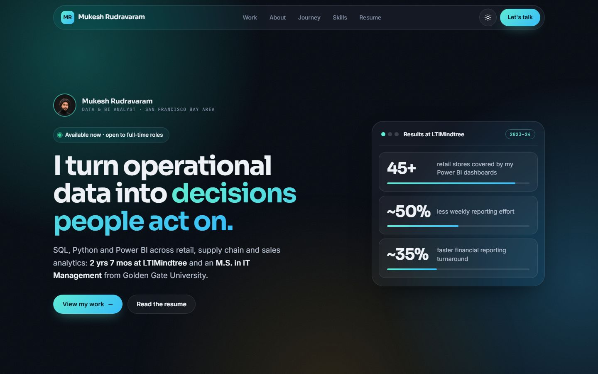

# Mukesh Rudravaram — Portfolio

**Version 1.1** · [Changelog](CHANGELOG.md) · [License](LICENSE)

Personal portfolio of **Naga Mukesh Chandra Naidu Rudravaram**, a Data & BI Analyst in the San Francisco Bay Area. SQL, Python and Power BI across retail, supply chain and sales analytics.

**Live site:** https://mukeshhchandra.github.io/Mukesh-Chandra-Portfolio-v1.1/



## About the project

A single, self-contained web page: no framework, no build step, no tracking. Everything (markup, styles and scripts) lives in [`index.html`](index.html), so it loads fast and can be hosted anywhere that serves static files.

### Sections

| Section | What it shows |
|---|---|
| **Hero** | Headline, availability, and a results card with three outcomes from LTIMindtree |
| **Work** | Four projects; each card opens a full case study (problem, approach, stack, status, links) |
| **About** | Short bio and key facts |
| **Journey** | Timeline of experience and education |
| **Skills** | 44 skills tagged by where they were used: production, project or academic, with filters and a "Show evidence" switch |
| **Resume** | Full resume with a "Quantified only" filter and **Save as PDF** |
| **Contact** | Email, LinkedIn and GitHub |

### Design and engineering

- **Aurora glass theme:** frosted, translucent panels over slowly drifting colour light, in dark and light modes. Switching themes uses the View Transitions API for a circular reveal.
- **Case studies with no JavaScript needed:** built on the native Popover API, with `@starting-style` for the open and close animation.
- **Accessible:** skip link, visible focus rings, labelled controls, a keyboard-friendly mobile menu, and full support for `prefers-reduced-motion`.
- **Works without JavaScript:** every section is readable with scripts off; JavaScript only adds filters, the theme switch and transitions.
- **Responsive:** checked at 1440, 1024, 768, 390 and 320 px with no horizontal overflow and equal content edges.
- **Print-ready resume:** a print stylesheet turns the Resume section into a clean one-document PDF.
- **Light:** about 95 KB of HTML plus one WebP photo; the only outside request is for Google Fonts (Sora, Inter, JetBrains Mono).

### Tech

HTML5 · CSS (custom properties, `color-mix()`, `backdrop-filter`, container-free responsive grid) · vanilla JavaScript · Popover API · View Transitions API · IntersectionObserver

## Run it locally

```bash
git clone https://github.com/Mukeshhchandra/Mukesh-Chandra-Portfolio-v1.1.git
cd Mukesh-Chandra-Portfolio-v1.1
python -m http.server 8765
```

Then open http://127.0.0.1:8765/index.html.

## Deploy with GitHub Pages

1. Open the repository's **Settings → Pages**.
2. Under **Build and deployment**, choose **Deploy from a branch**, branch **`main`**, folder **`/ (root)`**, and save.
3. The site goes live at `https://mukeshhchandra.github.io/Mukesh-Chandra-Portfolio-v1.1/` within a minute or two.

The `.nojekyll` file tells GitHub Pages to serve the files exactly as they are.

## Repository structure

```
index.html                  the whole site: markup, styles and scripts
images/mukesh-studio.webp   portrait used in the hero and About
docs/preview.jpg            screenshot used in this README
docs/share.jpg              link-preview image for LinkedIn and other sites
CHANGELOG.md                what changed in each version
LICENSE                     MIT for the code; personal content reserved
.nojekyll                   serve files as-is on GitHub Pages
.gitignore                  files kept out of the repository
```

## Contact

- Email: [mukeshhchandra@gmail.com](mailto:mukeshhchandra@gmail.com)
- LinkedIn: [Mukesh Rudravaram](https://www.linkedin.com/in/naga-mukesh-chandra-naidu-rudravaram-813298397)
- GitHub: [@Mukeshhchandra](https://github.com/Mukeshhchandra)

## License

The code is released under the MIT License. Photographs, screenshots and personal content (name, biography, resume and project descriptions) are not covered and remain all rights reserved. See [LICENSE](LICENSE).
